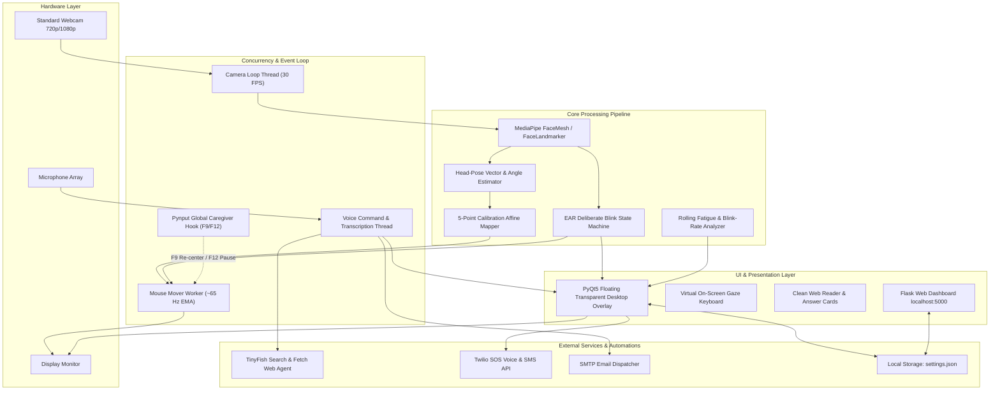
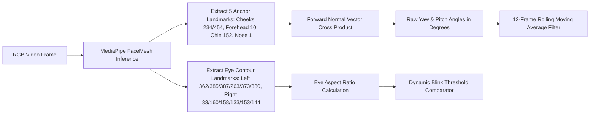
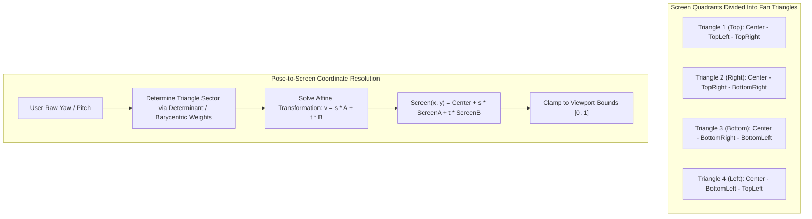
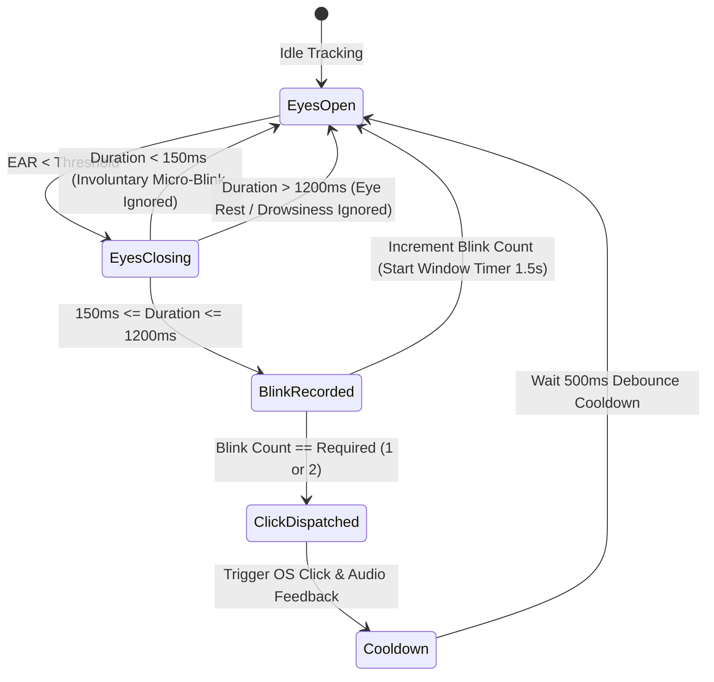
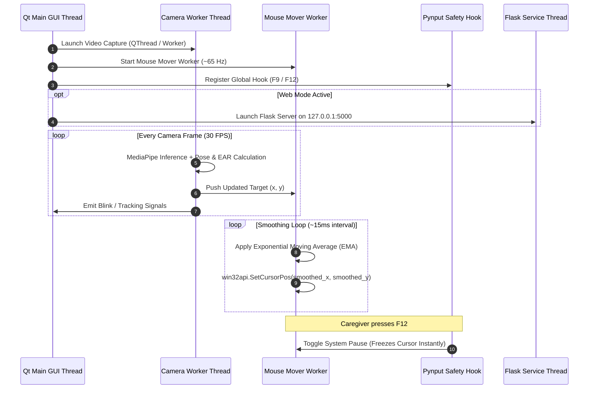
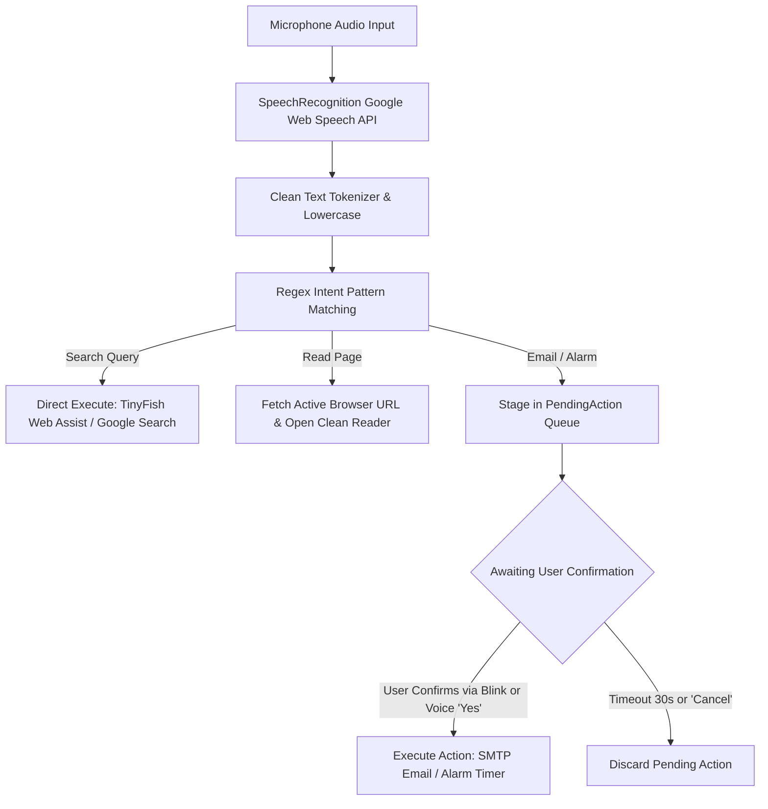

# OptiKinesis — Technical Design Document

**Author**: Govind Upadhyay  
**System**: OptiKinesis Assistive Computer Interaction Platform  
**Target Platform**: Windows 10/11 (Webcam-first, optional cross-platform web mode)  
**Version**: 1.0.0  

---

## 1. System Overview

OptiKinesis is a real-time, software-only assistive interface engineered for individuals with severe motor impairments (such as Amyotrophic Lateral Sclerosis / Motor Neuron Disease, quadriplegia, or spinal cord injuries) who cannot use a physical keyboard or mouse. 

The system transforms a standard consumer laptop webcam into an accurate input device by coupling:
1. **Facial landmark tracking & head-pose orientation estimation** for cursor steering.
2. **Eye Aspect Ratio (EAR) deliberate blink detection** for left/right mouse clicks.
3. **An on-screen floating PyQt5 overlay** providing a virtual gaze-operated keyboard, quick phrases, browser reader, and emergency SOS triggers.
4. **Natural language voice command automation** for hands-free daily workflows (search, email, timers).

---

## 2. High-Level System Architecture

The following diagram illustrates the interaction between system hardware, real-time background threads, algorithmic processing engines, the user interface layer, and external integrations.



---

## 3. Computer Vision & Landmark Processing Pipeline

Face tracking utilizes Google MediaPipe's FaceLandmarker model (`face_landmarker.task`, 478 3D landmarks) running at camera native frame rates (typically 30 FPS).



### 3.1 Head Pose Calculation
The head pose orientation vector $\vec{V}$ is computed using the spatial cross-product of horizontal cheek vectors and vertical forehead-to-chin vectors:
$$\vec{H} = P_{\text{cheek\_right}} - P_{\text{cheek\_left}}$$
$$\vec{V}_{\text{vert}} = P_{\text{chin}} - P_{\text{forehead}}$$
$$\vec{N} = \vec{H} \times \vec{V}_{\text{vert}}$$
The resulting normal vector is transformed into spherical Euler angles ($\text{Yaw}, \text{Pitch}$) centered near $180^\circ$ at neutral gaze.

### 3.2 Eye Aspect Ratio (EAR) Formulation
Eye openness is calculated via EAR:
$$\text{EAR} = \frac{\|p_2 - p_6\| + \|p_3 - p_5\|}{2 \|p_1 - p_4\|}$$
Where $p_1 \dots p_6$ correspond to 2D landmark coordinates of eye eyelids. When $\text{EAR} < \text{threshold}$ (default: $0.22$), eyes are classified as closed.

---

## 4. 5-Point Calibration Engine

To accommodate different laptop positions, sitting postures, and user mobility ranges without requiring manual sensitivity tuning, OptiKinesis uses a 5-point calibration protocol.



- Corner targets are placed at a $10\%$ inset (`TARGET_INSET = 0.10`) from screen edges to avoid muscle strain.
- The mathematical projection naturally extrapolates outward to guarantee that screen corners and edges remain fully reachable.
- **Dynamic Re-centering (F9 key)**: Adjusts the calibrated center coordinate without distorting quadrant span coefficients.

---

## 5. Deliberate Blink-to-Click State Machine

Involuntary physiological blinks occur in $50\text{--}100\,\text{ms}$, while deliberate command blinks are held between $150\text{--}1200\,\text{ms}$. OptiKinesis implements a discrete finite-state machine to prevent unintentional clicks.



---

## 6. Concurrency & Threading Model

OptiKinesis utilizes a decoupled multi-threaded architecture to ensure UI responsiveness and zero mouse jitter:



---

## 7. Natural Language Voice Command Engine



---

## 8. Data Storage & Schema (`settings.json`)

Settings are stored in the root directory in `settings.json` (gitignored). Writes use an atomic write-and-rename pattern (`settings.json.tmp` $\to$ `settings.json`) to guarantee file integrity across unexpected shutdowns.

### Schema:
```json
{
  "emergency_contact": "+15551234567",
  "cursor_scope": 1.0,
  "blink_sensitivity": 0.22,
  "cursor_speed": 0.5,
  "blinks_to_click": 2,
  "blink_window": 1.5,
  "lock_delay": 0.5,
  "overlay_enabled": true,
  "mouse_control_enabled": true,
  "reader_font_px": 24,
  "head_calibration": {
    "version": 1,
    "created": 1740000000.0,
    "points": {
      "center": [180.0, 180.0],
      "top_left": [171.5, 173.2],
      "top_right": [188.5, 173.0],
      "bottom_right": [188.8, 186.5],
      "bottom_left": [171.2, 186.8]
    },
    "targets": {
      "center": [0.5, 0.5],
      "top_left": [0.1, 0.1],
      "top_right": [0.9, 0.1],
      "bottom_right": [0.9, 0.9],
      "bottom_left": [0.1, 0.9]
    }
  }
}
```

---

## 9. Safety, Failsafes & Caregiver Overrides

1. **Global Keyboard Hooks (`pynput`)**:
   - **F9**: Instantly re-centers cursor mapping on current head angle.
   - **F12**: Safety kill-switch that pauses mouse control immediately.
   - Keystrokes sent programmatically through the virtual keyboard are filtered to ensure they do not trigger caregiver safety keys.
2. **Fail-safe Screen Corners**: If head tracking diverges, turning away from the camera for $> 2.0$ seconds parks the cursor safely.
3. **Emergency SOS System**: Single gaze button triggers an emergency broadcast via SMS/call to the registered caregiver contact using Twilio API.

---

## 10. Performance Specifications & Latency Profile

| Metric | Measured Target | Optimization Applied |
|---|---|---|
| Camera Latency | $\le 33\,\text{ms}$ | MediaPipe GPU/DirectShow buffer sizing |
| Cursor EMA Update Rate | $\sim 65\,\text{Hz}$ | Decoupled high-frequency worker thread |
| Blink Detection Latency | $\le 160\,\text{ms}$ | Immediate edge transition trigger |
| Overlay Render Rate | $60\,\text{FPS}$ | PyQt5 hardware-accelerated paint events |
| Voice Command Parse Time | $< 2\,\text{ms}$ | Precompiled deterministic regular expressions |
